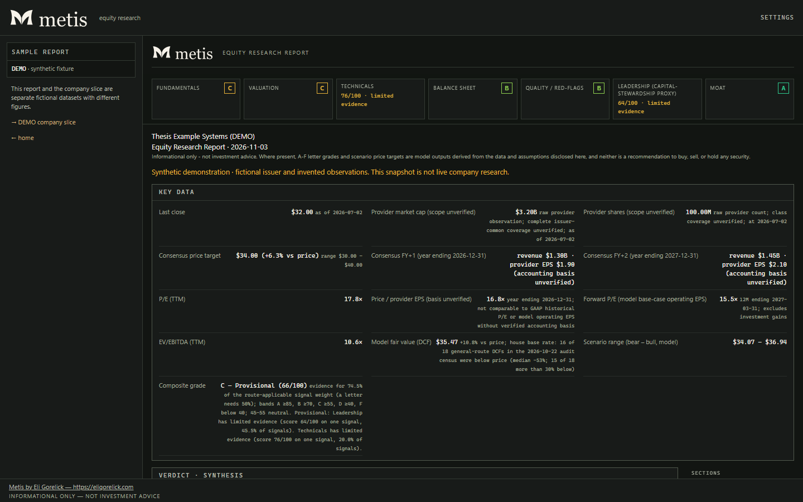
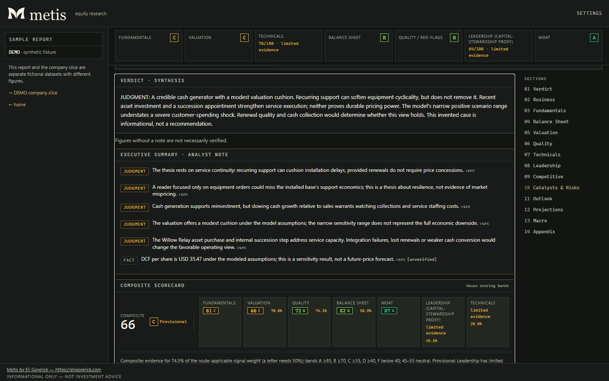
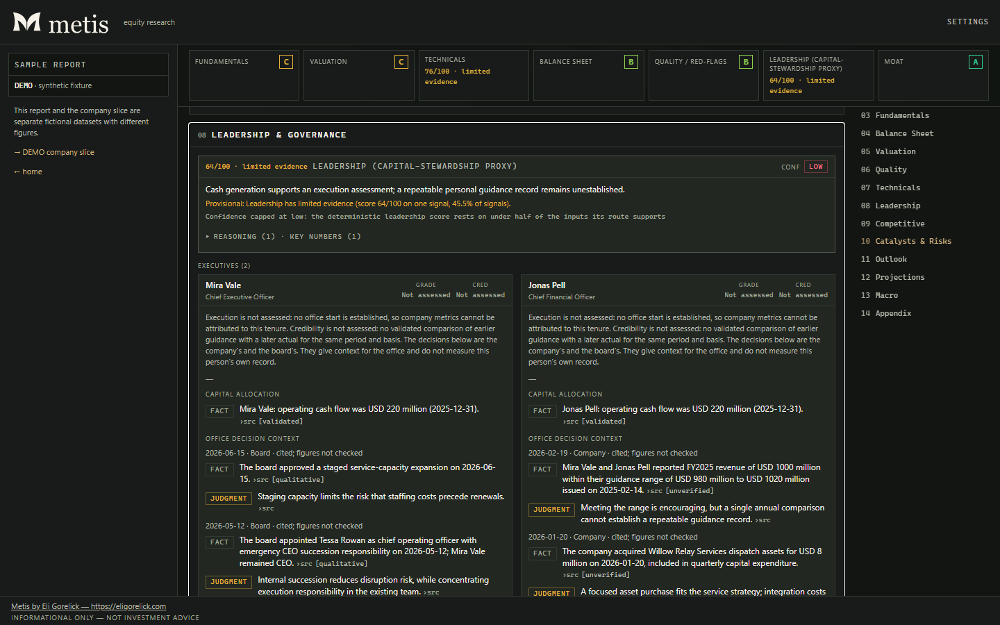

# Metis

[](https://github.com/eligorelick/Metis/actions/workflows/ci.yml)  [](LICENSE)


**Metis turns SEC filings, issuer disclosures and market data into equity research you can inspect.** It runs on your own computer, computes financial analysis in deterministic TypeScript, and can add AI bull and bear cases with a judge's synthesis. Source records, assumptions, verification results and data gaps stay alongside the report. It is built for individual investors and equity researchers reviewing US-listed companies ([brand guide](docs/BRAND.md)).

> **Informational only — not investment advice.** Grades and price targets are model outputs from disclosed data and assumptions, not human recommendations. Market data and AI output can be delayed, incomplete, or wrong.

[Try the sample](#see-a-sample-report) · [Get started](#quick-start) · [Methodology](docs/METHODOLOGY.md) · [Validation](docs/VALIDATION-STATUS.md) · [Contribute](CONTRIBUTING.md)

## What a report covers

Verdict and executive summary · how the company makes money, its segments, and its market and industry structure · fundamentals and quarterly trends · balance sheet and capital · valuation (a sector-appropriate intrinsic value, multiples against history and peers, sensitivity grids, reverse DCF) · quality and forensic red flags · technicals · leadership, compensation and insider activity · competitors and moat · dated catalysts and risks · outlook and weighted bull/base/bear projections · macro context · an appendix of sources, data gaps and verification results.

## See a sample report

From `/report/sample`: a fictional company, with real code outputs on invented inputs.







## How it works

1. **Collect.** Typed data from Financial Modeling Prep, SEC EDGAR, Yahoo Finance, FINRA, FRED, Finnhub, the U.S. Treasury and an EDGAR-confirmed issuer's own website, checked for freshness, balance-sheet identities and selected vendor figures against EDGAR XBRL.
2. **Compute.** Growth, returns, capital structure, valuation, scenarios, technicals, grades and forensic indicators on a sector route (industrial, bank, insurer, REIT and others) drawn from the industry label and SIC code and checked against filed facts. Missing inputs become disclosed gaps, never guesses.
3. **Analyse (optional AI).** Independent bull and bear analysts research recent developments, the market and the competitors, then a judge weighs both cases and writes the report.
4. **Verify.** Cited figures are traced to the record they cite, and the prose around them is checked for direction, period and unit, without another model call.

## Quick start

Node.js 24 or newer and npm are required (`package.json`); use Node 24 for development. CI tests Node 24. Windows is the primary development platform. macOS/Linux use the npm commands below; CI runs the full gate on Linux and product/integration smoke checks on Windows.

```powershell
git clone https://github.com/eligorelick/Metis.git
cd Metis
npm ci
Copy-Item .env.example .env
npm run dev
```

On macOS/Linux, use `cp .env.example .env`. Production: `npm run build`, then `npm start`. Keep `.env*` private; only the placeholder `.env.example` belongs in Git. **Settings → Provider keys and SEC contact** offers **Save**, **Test**, and **Remove saved** for each value; a green check confirms usable provider test data. Saved values use protected local storage, override environment keys, and apply without restarting. Removing an override restores any environment value and keeps account connections intact. Existing saved keys stay hidden; tests do not generate paid Claude responses.

Open <http://127.0.0.1:3000>; development and production both bind to `127.0.0.1`. Every provider key is optional: with no `FMP_API_KEY`, set
`EDGAR_CONTACT` to a truthful "Name email" identity and real US-listed tickers
come from SEC EDGAR and Yahoo. With no key at all, open the **[sample report](http://127.0.0.1:3000/report/sample)**, a complete fictional report. `/company/DEMO` and `/company/DBNK` are reserved strings
served from `fixtures/fmp` whatever keys are set. None reaches a market-data provider: the company slices disclose fixtures and the sample is synthetic.
Other symbols use live/cache data; generating fixture reports can still call selected AI.

No paid API key is required to try the app. For real keyless research, SEC EDGAR requires `EDGAR_CONTACT` (a contact identity, not a key). Optional keys: `FMP_API_KEY` for vendor data, `FRED_API_KEY` for macro requests, `FINNHUB_API_KEY` for Finnhub, and `ANTHROPIC_API_KEY` only for Claude API analysis. `ANTHROPIC_ADMIN_KEY` is only for optional cost reconciliation. Configure provider keys and the SEC contact in `.env` or Settings; Settings also supports Save, Test and Remove saved for the optional admin key in protected local storage. See the configuration table below for limits and defaults.

Claude API analysis is separately billed. The checked-in registry's illustrative run estimates range from about **$1.30 to $8.60**, with default Opus 5.5 around **$3.42**; actual charges vary with tokens, research, retries and effort. These are neither measured prices nor spending caps. Measured complete runs in November 2026 cost $1.62 (Haiku 4.5 analysts at medium effort with the Sonnet 5.5 judge), $2.28 (Sonnet 5.5 at high), $4.71 (Opus 5.5 at high), $12.27 (Opus 5.5 at extra high), $3.08 (Sonnet 5.5 on JPM) and $6.30 (Opus 5.5 on NVO), so expect more than the estimate at higher effort. See [Claude usage and cost controls](docs/CLAUDE-USAGE.md) and the detailed pricing table below.

## AI connections

In **Settings → AI connections**, connect ChatGPT through official plan OAuth or Google through the separately installed Gemini CLI **0.36.x**, then save. ChatGPT supports account model refresh, GPT-6.1 Sol with an access notice,
reasoning choices and opt-in Fast speed. Reports retain actual execution details.
Sign-in runs no inference; failures never switch to paid API usage. Claude API
remains separately billed. Plan allowances and credit settings apply; API dollar
caps do not measure them. See [setup, controls and limits](docs/PRIVACY.md#ai-connection-setup).
Connections have offline test coverage, and complete reports have run live through a ChatGPT connection; inference through a live Gemini account has not been verified. Stop all Metis servers before changing credential-lock versions; see [upgrade/downgrade guidance](docs/PRIVACY.md).

## Configuration

<!-- BEGIN GENERATED: config -->

Every key is optional. This table is generated from `.env.example`, which carries the long form of each one.
Its `METIS_*` lines ship commented out: a key that is set, even blank or invalid, wins over its legacy
`THESIS_*` alias, so uncomment only what you mean to set. See [compatibility](docs/BRAND.md#compatibility).

| Key | Shipped value, built-in default or opt-in example | What it does |
| --- | --- | --- |
| `FMP_API_KEY` | unset | Financial Modeling Prep key — any plan. |
| `ANTHROPIC_API_KEY` | unset | Anthropic key enables Claude analyst/judge passes when Claude API is selected. |
| `FRED_API_KEY` | unset | FRED key enables authenticated macro-series requests. |
| `FINNHUB_API_KEY` | unset | Finnhub — free-tier key. |
| `EDGAR_CONTACT` | unset | SEC EDGAR is keyless but REQUIRES a declared contact in the User-Agent of every request. |
| `METIS_STATEMENT_SOURCE` | `auto` | Where the income statement, balance sheet and cash flow history comes from. |
| `ANALYSIS_MODEL` | `auto` | Claude model used when the Claude API connection is selected. |
| `ANALYSIS_EFFORT` | `high` | Claude reasoning effort: low \| medium \| high \| xhigh \| max. |
| `METIS_JUDGE_ORDER` | `random` | Which order the judge/synthesis pass reads the two analyst cases in. |
| `ANTHROPIC_ADMIN_KEY` | unset | Optional Admin API key (distinct from ANTHROPIC_API_KEY). |
| `METIS_MAX_ACTIVE_JOBS` | `1` | Maximum concurrent report jobs across processes sharing the SQLite database. |
| `METIS_MAX_ACTIVE_LLM_CALLS` | `2` | Maximum concurrent paid Claude permits across processes sharing the SQLite database. |
| `METIS_MAX_JOB_COST_USD` | unset | Optional exact USD caps. |
| `METIS_MAX_ROLLING_COST_USD` | unset | Optional exact USD caps. |
| `METIS_RESERVATION_MODE` | `request` | How paid work is admitted against these caps: one reservation per provider request, or one per pass. |
| `METIS_STREAM_IDLE_SECONDS` | `300` | Base gap with no stream event after which a paid request is abandoned, scaled by analysis effort. |
| `METIS_ROLLING_COST_WINDOW_MINUTES` | `1440` | Rolling paid-cost window in minutes (1440 means 24 hours). |
| `METIS_PAID_PASS_LEASE_SECONDS` | `900` | Paid-pass lease lifetime in seconds, renewed every quarter of its TTL. |
| `METIS_JOB_LEASE_SECONDS` | `900` | Job-claim lease lifetime in seconds, never shorter than the paid-pass lease. |
| `METIS_RESUME_ON_START` | `1` | Automatically resume queued work at startup with 1, or hold it with 0. |
| `METIS_EV_INCLUDE_LEASES` | `1` (opt in) | Include a separable operating-lease liability only when explicitly set to 1. |
| `METIS_ALLOWED_HOST` | unset | `npm run dev` and `npm start` bind to 127.0.0.1 by default. |
| `METIS_TOKEN_FILE` | unset (opt in) | Override the startup token file path (default `<data dir>/csrf-token`). |
| `METIS_DB_PATH` | unset (opt in) | Override the SQLite file (fresh default `<data dir>/metis.db`, with existing `thesis.db` or recovery files reused). |
| `METIS_DATA_DIR` | unset (opt in) | Override the app-data directory used by the default DB and startup token. |
| `METIS_IMPORT_LEGACY_DB` | `1` (opt in) | One-time migration only. |
| `METIS_UI_REDESIGN` | `0` | Opt into the dossier UI. |
| `NEXT_TELEMETRY_DISABLED` | `1` | The Next.js CLI behind `npm run dev` / `npm run build` posts anonymous usage events to telemetry.nextjs.org unless this is set. |

<!-- END GENERATED: config -->

Claude model/effort settings beat environment/defaults; reset with `npm run settings:reset -- --yes`. [Operations](docs/OPERATIONS.md) covers AI selection, jobs, exports and API contracts.

## Where the numbers come from

With an FMP key, FMP is the default provider unless the statement policy selects EDGAR.
Restricted endpoints and history limits use bounded retries, available fallbacks or
disclosed gaps. Five annual periods can support some calculations; the own-history
multiple rank still needs eight compatible quarterly observations.

Configure `EDGAR_CONTACT` even with a free FMP key. Metis learns explicit access
restrictions and skips repeat refusals for 15 minutes; see [fallback limits](docs/PRIVACY.md#limited-fmp-access).

With no FMP key, set `EDGAR_CONTACT` for real US filers' research: supported statements, share counts and public float from SEC EDGAR XBRL company facts, prices from Yahoo's unofficial chart endpoint, and the profile and enterprise values derived from the two. `METIS_STATEMENT_SOURCE` chooses between the vendor and EDGAR; no statement row mixes source fields, and the manifest names how many each served.

Where a filer uses an extension tag the field is `null` rather than a guess,
and each stand-in is named in the manifest with the periods it served. Analyst
estimates, price targets, peers, insider trades (SEC Form 4), institutional
ownership, news, transcripts and executive compensation have no implemented
keyless source. SEC quarterly segment coverage is partial; IFRS-only facts remain gaps.
See [License and data rights](docs/DATA-RIGHTS.md) for what each allows.

## What the numbers mean

[Methodology](docs/METHODOLOGY.md) defines sources, sector eligibility and house
conventions. Banks, insurers and mortgage REITs use applicable equity models;
unsupported industrial metrics stay excluded. Growth shows supported methods;
free cash flow shows before/after stock-based compensation; history ranks show sample size.
Grades are **Provisional** when key applicable evidence is missing or limited.
Supported older values may appear as dated references, with no current upside or targets.

[`docs/RESEARCH.md`](docs/RESEARCH.md) documents the forensic scores' papers,
coefficients, estimation populations and limits; the source cites it by section.

With AI off or unavailable, reports retain deterministic results and disclose
missing analysis. Failed AI runs may retain charges and produce such a report: it has no analyst assessment, and any letter grade is a deterministic score band.
Plan-run recovery files in `<data dir>/recovery/sections` stay until deleted with Metis stopped. If the AI connection store cannot be read, saved reports stay readable but new jobs do not start. Settings follows a saved Claude key unless a connection was chosen explicitly. LAN mode disables credential and connection management.

## AI analysis

Two analysts independently build bull and bear cases without seeing each other's output; the bear prompt forbids assuming a bull case exists. They share evidence, so agreement is not independent factual corroboration.
The rubric discourages double-counting repeated disclosures or derived metrics while allowing distinct facts from one filing.
This is prompt guidance, not a deterministic evidence count or calibrated probability. Each analyst rates its case 1–5; a judge reads both, may discount a weak case, and writes the report.
Judge order comes from the job id and appears in the header. Both cases share a character target; actual lengths and protected-content excess are disclosed. `METIS_JUDGE_ORDER=both` compares every section grade with case order swapped; retries retaining earlier sections skip it.

The [prospective study workflow](docs/REPORT-EVALUATION.md#prospective-report-studies) predeclares slots and baselines, freezes reports before deadlines and retains every planned issuer, including missing reports and outcomes.
It groups descriptive errors by sector and exact horizon with paired baseline comparisons. Neither the rubric nor local registration establishes forecast accuracy or historical source truth. Strict forecast admission still requires an upstream producer of complete typed measurement definitions; predefined cohorts, point-in-time inputs and later outcomes are needed to assess accuracy.

Scorecards show each attribute's missing-input score range and conditional bands from recorded applicable coverage: arithmetic sensitivity, not probabilities. Valuation robustness requires complete modeled grids, including when displaying saved reports. Evidence timing distinguishes contemporaneous capture, later-acquired inputs and unverified historical timing.

The verification pass makes no model call. It measures citation coverage — can each figure be traced to the record it cites — and separately checks the prose around figures it can locate: a direction word must match the sign of its change, a period naming a year must match the cited year (and a comparison base the period the figure is measured against), a unit word must fit the registered unit, and a claim naming a person must rest on a filing, a transcript, a registry figure or attributed executive/insider rows; any other source, or none, fails it. Checked is printed beside cited, never merged into it.

Claude model prices and limits come from `config/models.json`; unknown IDs
degrade to data-only reports because their spend cannot be bounded. `auto`
prefers Opus 5.5; Haiku's judge uses Sonnet 5.5 with a disclosed model floor.
See [Claude model, effort and usage guidance](docs/CLAUDE-USAGE.md).

<!-- BEGIN GENERATED: pricing -->

Registry snapshot 2026-10-03, generated by `npm run docs:pricing`
from `config/models.json` and the reservation code. Each request is admitted
against spend caps using up to ten input contexts per search-enabled model,
at five-minute research / one-hour synthesis cache-write rates, plus output and configured fallback exposure.
Each analyst researches with up to eight $0.01 searches, then writes without tools under a separate reservation; the judge never searches.

| Analysis model | One analyst request | One synthesize request | Analyst pass worst case | Primary output ceiling | Estimated run |
| --- | ---: | ---: | ---: | ---: | ---: |
| Claude Fable 5.1 | $197.18 | $39.60 | $7,268.58 | $3.20 → $6.40 | $8.34 |
| Claude Fable 5 | $197.18 | $39.60 | $7,268.58 | $3.20 → $6.40 | $8.60 |
| Claude Opus 5.5 | $52.64 | $10.56 | $1,940.40 | $1.28 → $2.56 | $3.42 |
| Claude Opus 5 | $65.78 | $13.20 | $2,424.78 | $1.60 → $3.20 | $4.34 |
| Claude Opus 4.8 | $65.78 | $13.20 | $2,424.78 | $1.60 → $3.20 | $4.34 |
| Claude Sonnet 5.5 | $26.36 | $5.28 | $971.64 | $0.64 → $1.28 | $1.75 |
| Claude Sonnet 5 | $26.36 | $5.28 | $971.64 | $0.64 → $1.28 | $1.78 |
| Claude Haiku 4.5 | $2.90 | $5.28 | $107.82 | $0.32 | $1.30 |

The worst case is every request one pass could make (36: six transport attempts,
each able to pause and resume five times, plus six tool-free writing attempts); in the default request mode it is
reported, not reserved; a job cap covers settled spend plus in-flight reservations, while
`METIS_RESERVATION_MODE=pass` reserves it whole. Neither reservation column varies
with effort — both bound a request at the model's full context and output ceiling.

The primary-model output ceiling varies with effort; thinking bills as output.
Below `high`, passes use analyst 64K/judge 96K; at `high` and above, the model's
registry ceiling applies. Fallback output is additional and covered by request
reservations. A cut-off request is presumed at its worst case until reconciled.

The estimated run is a calculation, not a measurement: the fixture shape at effort
`high` and registry rates, with assumed research and writing token splits and three synthesis sections; Haiku's synthesize figures are those of Claude Sonnet 5.5
because that pass is raised to it. The estimate does not scale with effort.
Measured whole-report costs at several effort levels are listed above.
Higher effort can consume more tokens; these examples are neither minimum nor
maximum prices, and the measurements do not establish model quality.

<!-- END GENERATED: pricing -->

## Running it safely

Metis has no telemetry, analytics or update check; its own outbound traffic goes only to the providers you configure and an EDGAR-confirmed issuer's own website. The Next.js CLI has separate anonymous telemetry, off when the shipped `NEXT_TELEMETRY_DISABLED=1` is in your `.env` (or `npx next telemetry disable`). [Privacy and safety](docs/PRIVACY.md) names what each receives, where the local database lives, and how to delete it.

The application is single-user and has no authentication; keep it on loopback
unless you add a security layer of your own. Mutating routes reject a request
carrying neither browser Fetch Metadata nor a matching `Origin`; browsers send
those automatically; scripts send `X-Metis-Token` (legacy `X-Thesis-Token` accepted) with the contents of
the `csrf-token` file the server writes at every start and names on stdout. That
is a browser-CSRF boundary, not local access control: any process on the machine
can present the same headers. Report security problems through the
repository's [private advisory form](https://github.com/eligorelick/Metis/security/advisories/new), not a public issue.

## Commands

<!-- BEGIN GENERATED: commands -->

| Command | What it does |
| --- | --- |
| `npm run dev` | Run the app on 127.0.0.1 in development. |
| `npm run build` | Production build. |
| `npm run start` | Serve the production build on 127.0.0.1. |
| `npm run sample:build` | Rebuild the fictional sample report and matching charts offline; no provider or model calls. |
| `npm run typecheck` | Type-check without emitting. |
| `npm run lint` | ESLint over the repository. |
| `npm run test` | The product test suite. Fully offline whatever .env holds. |
| `npm run test:changed` | Only the tests related to files changed against `origin/main`. |
| `npm run test:integration` | The database CLI suite, which runs in its own process. |
| `npm run test:coverage` | Both coverage contracts, core and risk. |
| `npm run test:watch` | The product suite in watch mode. |
| `npm run export:corrected` | Write corrected HTML/JSON from a stored run; requires new output filenames. |
| `npm run research:evaluate` | Evaluate frozen point-in-time forecasts offline; never changes production grades. |
| `npm run research:replay` | Reproduce Stage B from an immutable input snapshot without provider or model calls. |
| `npm run reports:evaluate` | Freeze immutable report snapshots and evaluate explicitly comparable outcomes offline; see docs/REPORT-EVALUATION.md. |
| `npm run claims:evaluate` | Evaluate claim-checker outputs against explicit synthetic or human-reviewed references offline; see docs/REPORT-EVALUATION.md. |
| `npm run settings:reset` | Delete stored settings rows so .env takes precedence again. Needs --yes. |
| `npm run db:push` | Apply the Drizzle schema to the configured database. |
| `npm run check:dependencies` | Assert the dependency tree's shape. |
| `npm run models:refresh` | Diff config/models.json against the published model list and prices. Sends no model request. |
| `npm run costs:reconcile` | Lower presumed spend rows against the Usage and Cost API. Needs ANTHROPIC_ADMIN_KEY. |
| `npm run docs:config` | Print config/commands tables; add -- --write to update README. |
| `npm run docs:pricing` | Print registry-derived pricing; add -- --write to update README. |
| `npm run audit:deltas` | Print fixture comparison's intended deltas; add -- --write to update the intended-delta list. |
| `npm run audit:security` | Audit production and dev dependencies; fail on low or higher severity. |
| `npm run verify` | Everything the release gate runs, in order. |

<!-- END GENERATED: commands -->

The product suite makes no network request whatever your `.env` contains; one
live SEC check is opt-in with `EDGAR_LIVE_SMOKE=1` and a real `EDGAR_CONTACT`.
Protect `main` by requiring the `full` and `windows-smoke` checks in GitHub.
Contributions should preserve source tracing, add regressions and pass `npm run verify`.

## Troubleshooting

- **Install or native SQLite errors:** check `node --version` is Node 24, then run `npm ci` in the repository root. Do not reuse `node_modules` across operating systems or Node versions.
- **App does not open:** use the URL printed by the npm server (normally http://127.0.0.1:3000). Check for another process using port 3000. Production startup needs `npm run build` first; local Windows launchers do not build or install dependencies.
- **Missing figures or unsupported symbol:** configure a truthful `EDGAR_CONTACT`, test optional provider keys in Settings, and read the report's disclosed gaps. Plan restrictions and unsupported instruments do not become guessed values; see [data-source limits](docs/PRIVACY.md#limited-fmp-access).
- **AI missing or a run held:** check the selected AI connection, provider allowance and spend caps in Settings. A failed connection does not silently switch to paid Claude. See [jobs and recovery](docs/OPERATIONS.md#report-lifecycle-and-recovery) and [Claude guidance](docs/CLAUDE-USAGE.md).

For reproducible problems, use the repository's bug/data issue forms with sanitized diagnostics. Read [contribution guidance](CONTRIBUTING.md) before sending a patch, and [SECURITY.md](SECURITY.md) for private vulnerability reporting.

## Limitations

- Metis is a research tool for one local user, not a broker or a trading
  system. A traced number can still come from incorrect source data, and AI
  narrative can be wrong even when its citations resolve.
- Verification checks numeric content against dated registry records and retained
  passages; citation presence alone does not validate a claim or qualitative truth.
  Oversized analyst cases disclose removed material and any remaining excess.

## License and data rights

Metis is source-available under the [Metis No-Sale Attribution License 1.0](LICENSE), which lets you use, modify and redistribute the software, including internal business use, with attribution, but prohibits charging for copies, downloads or access without separate written permission. Distribution/download pages and software interfaces require visible credit: **Metis by [Eli Gorelick](https://eligorelick.com) — https://eligorelick.com**; see the license for CLI/headless equivalents. This is not an OSI-approved open-source license. Earlier MIT-licensed copies retain their prior rights. Preserve third-party notices; separate [data rights](docs/DATA-RIGHTS.md) apply to retrieved data and model output, including shared reports.

Charging for reports or other output is not itself prohibited by the code license, provided payment is not required for access to the software or its functionality; provider data and output terms still apply. Preserve notices, identify modifications and include the license when redistributing. The [license text](LICENSE) controls; this summary does not replace it.
